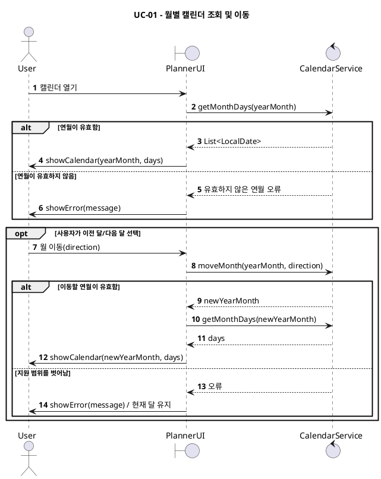
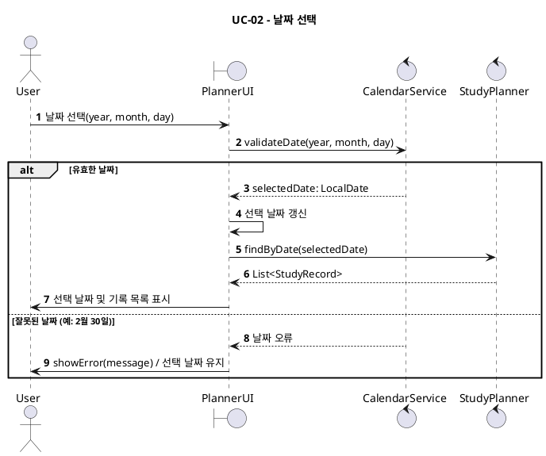
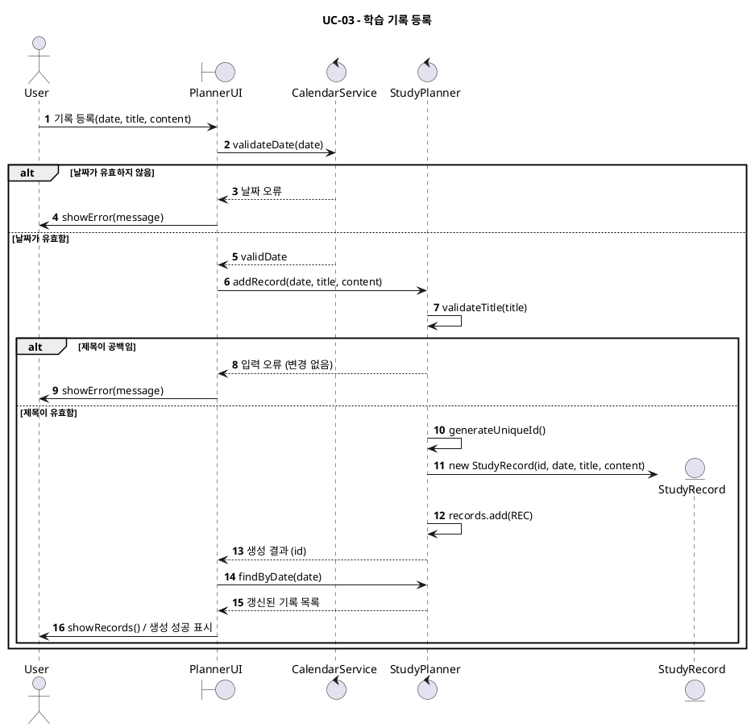
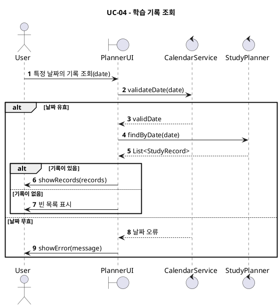
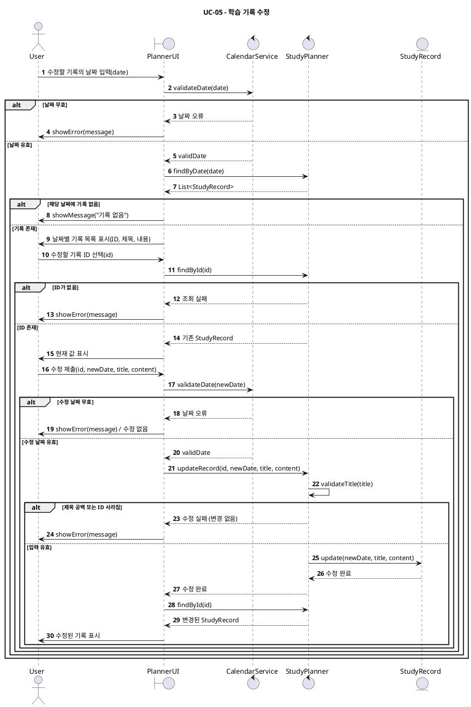
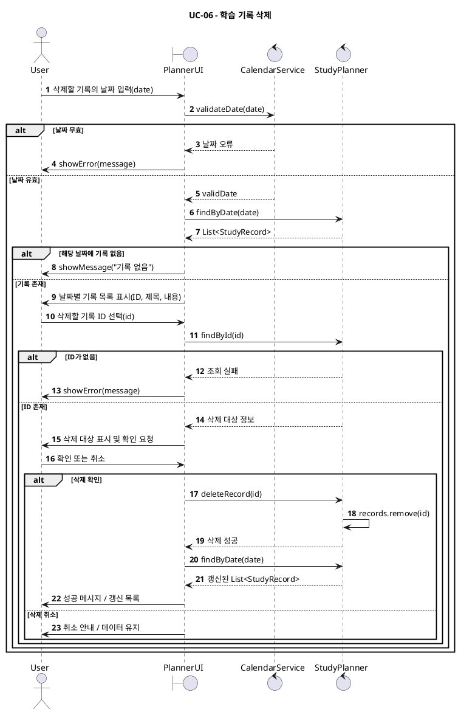
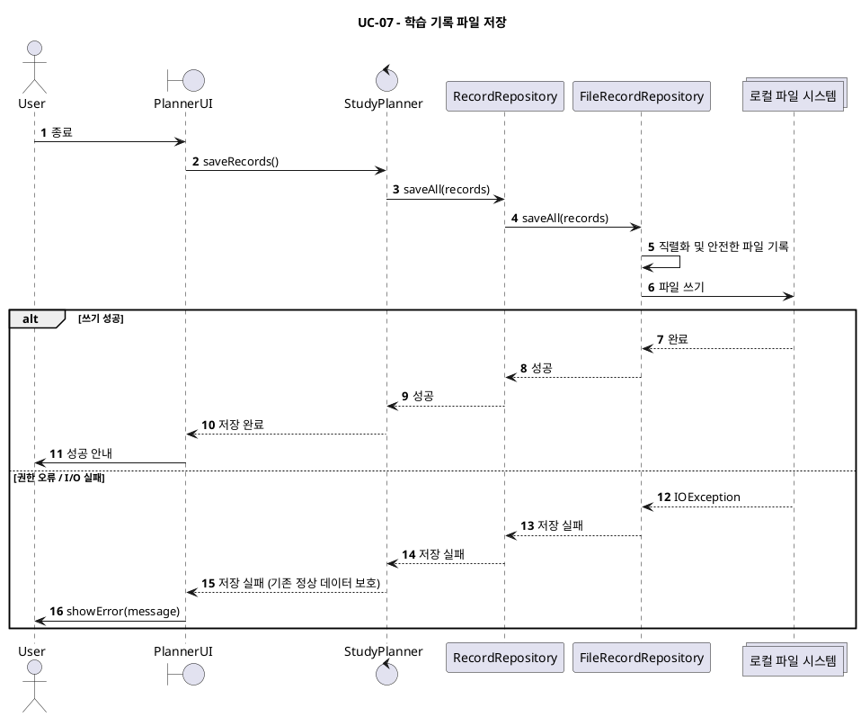
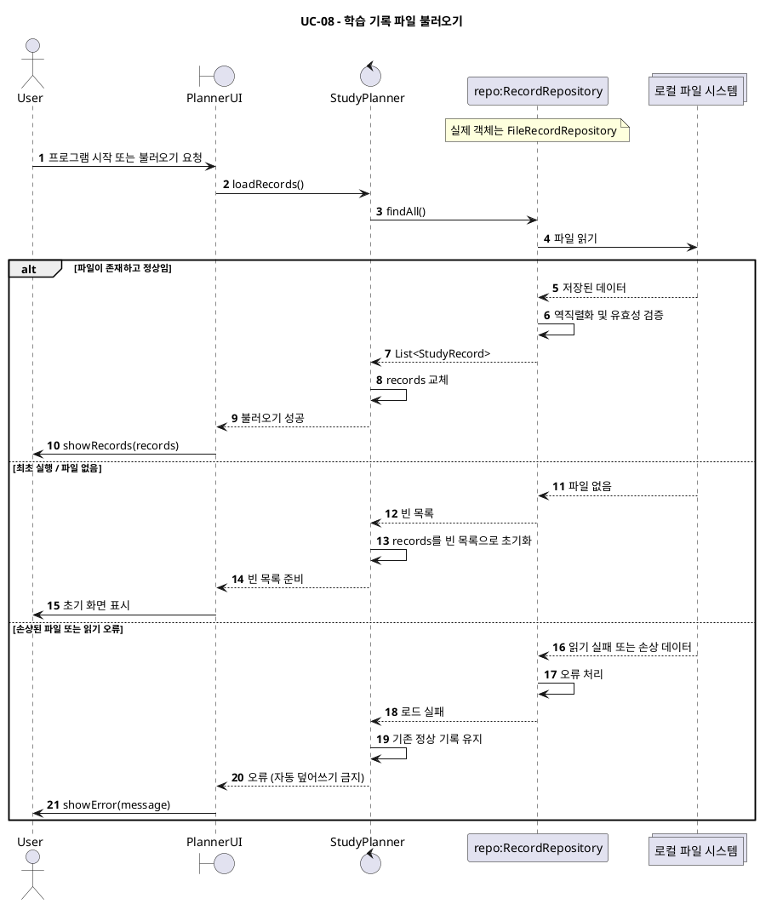
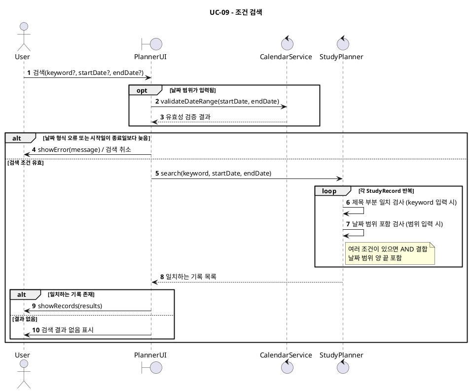

# Study Planner — Sequence Diagrams

## 작성 기준

- `alt`: 조건별 성공·실패 분기, `opt`: 선택적 기능, `loop`: 반복 검사.
- **SRS 확정 사항**: 필수 제목, 유효 날짜, 고유 ID, 삭제 확인, 파일 오류, 키워드·날짜 범위 AND 검색.
- **구체화한 설계 선택**: UI가 입력을 받아 `StudyPlanner`에 위임하고, 저장은 `RecordRepository`를 경유하며, 파일 오류 시 정상 기록을 보존하는 호출 구조. 실제 UI 형태, 직렬화 포맷, 자동 저장은 아직 미확정입니다.
- `FileRecordRepository`는 `RecordRepository`의 실제 구현체입니다. 저장·불러오기 시퀀스에서 인터페이스와 구현체를 함께 그린 화살표는 **추상 호출과 실제 구현 실행을 설명하기 위한 논리적 표현**입니다. 런타임에서는 보통 구현체 객체 하나가 호출을 받습니다.

## UC-01 — 월별 캘린더 조회 및 이동 (FR-01)

## UC-02 — 날짜 선택 (FR-02)

## UC-03 — 학습 기록 등록 (FR-03)

## UC-04 — 학습 기록 조회 (FR-04)

## UC-05 — 학습 기록 수정 (FR-04)

## UC-06 — 학습 기록 삭제 (FR-05)

## UC-07 — 학습 기록 파일 저장 (FR-06)

## UC-08 — 학습 기록 파일 불러오기 (FR-06)

## UC-09 — 조건 검색 (FR-07)

